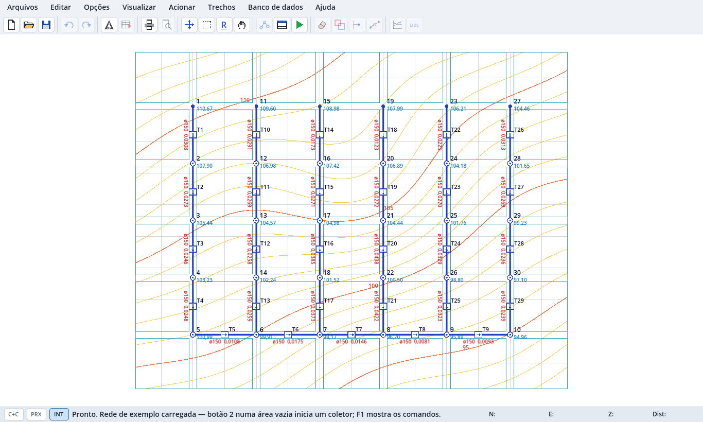
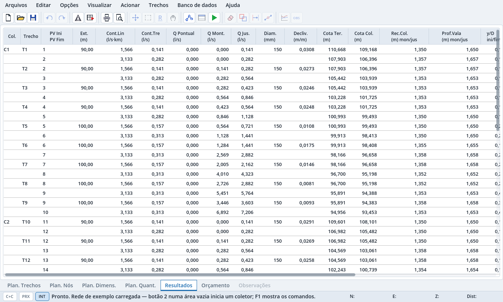
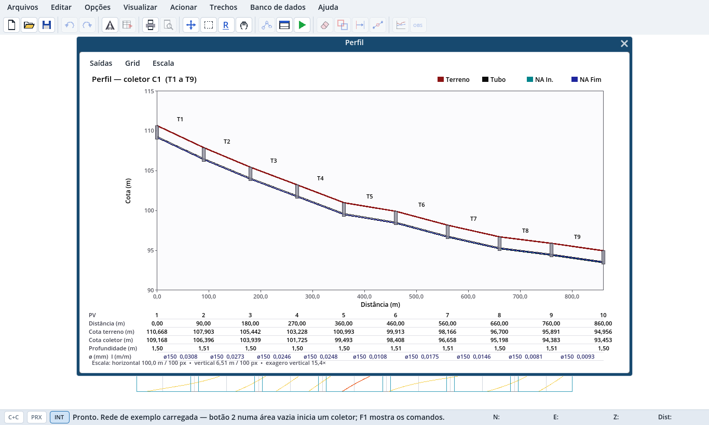

# DimEsgoto

**Projeto e dimensionamento de redes coletoras de esgoto sanitário** — traçado gráfico sobre topografia, cálculo hidráulico pelos critérios da NBR 9649, planilhas, orçamento, perfis e exportação para CAD.

> ⚠️ **Versão alpha (0.1.0-alpha).** Feita para avaliação. Os resultados devem ser conferidos por um responsável técnico e validados contra a norma vigente e as exigências da concessionária antes de qualquer uso em projeto real.



## Download

Baixe a última versão na página de [**Releases**](../../releases):

| Sistema | Arquivo | Como abrir |
|---|---|---|
| Windows 10/11 (64 bits) | `DimEsgoto-0.1.0-alpha-windows-x86_64.zip` | Extraia e abra `DimEsgoto.exe` |
| Linux (64 bits) | `DimEsgoto-0.1.0-alpha-linux-x86_64.zip` | Extraia e execute `./DimEsgoto.x86_64` |

Não precisa instalar nada. No Windows, como o executável ainda não é assinado, o SmartScreen pode avisar "editor desconhecido": clique em **Mais informações › Executar assim mesmo**.

Ao abrir, uma rede de exemplo já vem carregada e dimensionada. Aperte **F1** para ver os comandos.

## O que ele faz

**Traçado da rede**
- Área de trabalho estilo CAD. Botão direito inicia e termina um coletor, botão esquerdo cria os PVs, Shift continua o traçado e Ctrl marca trechos.
- Topografia em DXF (curvas de nível, ruas e pontos cotados, ASCII ou binário), com cota automática dos nós.
- Imagem de fundo, grade de coordenadas N/E, zoom, pan e janela.
- Desfazer e refazer (Ctrl+Z / Ctrl+Y).

**Dimensionamento**
- Vazões de início e fim de plano (população, consumo, coeficiente de retorno, K1, K2, infiltração e vazões pontuais).
- Fórmula de Manning ou Universal, com ajuste de rugosidade pela velocidade.
- Critérios: vazão mínima, tensão trativa, lâmina máxima, velocidade crítica e velocidade máxima, recobrimento e profundidade.
- Degraus, tubos de queda, cotas intermediárias do terreno e escoramento automático.
- Planilha de observações. Advertências e erros impeditivos são tratados separadamente.



**Entregáveis**
- Planilhas de trechos, nós, dimensionamento, quantitativos, resultados, orçamento e observações, exportáveis em CSV, XLSX, HTML e PDF.
- Memorial de cálculo (TXT/PDF) com identificador de rastreabilidade do resultado.
- Planta e perfil longitudinal em DXF; perfil também em PNG.
- Banco editável de materiais, tubos, PVs, pavimentos, escoramentos, reduções e acessórios.



**Cadastro e SIG**
- Ligações domiciliares em CSV, com relatório de importação (duplicadas, fora da área, sem consumo…).
- Bacias e sub-bacias em GeoJSON, com balanço de contribuições.
- Interferências em GeoJSON.
- Exportação e reimportação da rede em GeoJSON.

## Rodar a partir do código-fonte

Requisitos: [Godot 4.4.1](https://godotengine.org/download/archive/4.4.1-stable/) e Python 3 (opcional, para o iniciador e os testes).

```bash
# abrir o app
python3 app/main.py            # ou: godot --path app

# abrir no editor do Godot
godot -e --path app
```

## Testes

Os casos de avaliação estão em [EVALS.md](EVALS.md) e [tests/PHASE-2-5.md](tests/PHASE-2-5.md). O runner executa as fases em ordem e para na primeira que falhar:

```bash
python3 tests/run_tests.py                 # todas as fases (abre uma janela por alguns segundos nos testes visuais)
python3 tests/run_tests.py --sem-grafico   # só modo headless
python3 tests/run_tests.py --fase 1        # uma fase
```

O relatório sai em `tests/report/`. As decisões técnicas adotadas estão em [tests/DECISOES.md](tests/DECISOES.md).

## Gerar os executáveis

Com os [modelos de exportação do Godot 4.4.1](https://github.com/godotengine/godot/releases/tag/4.4.1-stable) instalados:

```bash
python3 tools/build_release.py   # gera dist/DimEsgoto-<versão>-windows-x86_64.zip e -linux-x86_64.zip
```

## Estrutura

```
app/        projeto Godot (GDScript)
  main.gd         janela principal, menus, planilhas, arquivos
  plan_view.gd    área de trabalho (traçado)
  calc.gd         motor de cálculo, quantitativos e orçamento
  net.gd          rede: nós, trechos, coletores, numeração
  topo.gd, dxf.gd topografia e DXF
  cadastro.gd     ligações, bacias e balanço
  geo.gd          GeoJSON
  report.gd       memorial, CSV/XLSX/HTML/PDF, DXF
  db.gd           banco de itens de custo
  registro.gd     registro de erros
tests/      suíte de avaliação (fixtures, referências, runner)
tools/      script de build
versoes/    versão anterior (tabela de trechos), preservada
docs/       imagens do README
```

## Dados do usuário e registro de erros

Configurações, banco de custos e registros ficam em:
- Windows: `%APPDATA%\Godot\app_userdata\DimEsgoto`
- Linux: `~/.local/share/godot/app_userdata/DimEsgoto`

Se algo der errado, abra **Ajuda › Registro de erros…**, use **Salvar relatório…** e anexe o arquivo a uma [issue](../../issues).

## Origem

O DimEsgoto foi inspirado nas funcionalidades descritas no manual do usuário do **CEsg** (FCTH), um programa clássico de projeto de redes de esgoto. Ele é um projeto independente, escrito do zero: não usa código do CEsg e não tem vínculo com a FCTH nem com a Tigre. Os nomes de materiais do banco de dados padrão são apenas exemplos editáveis.

## Licença

A definir.
